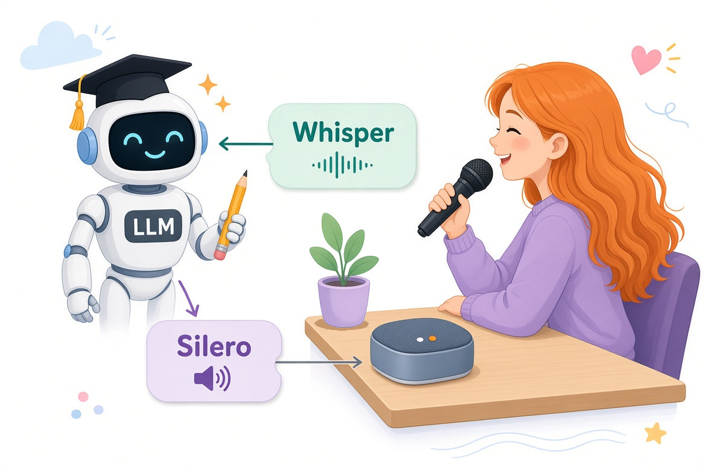
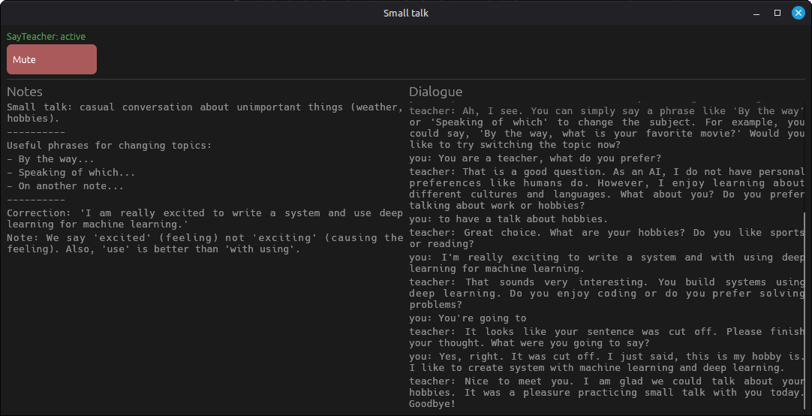
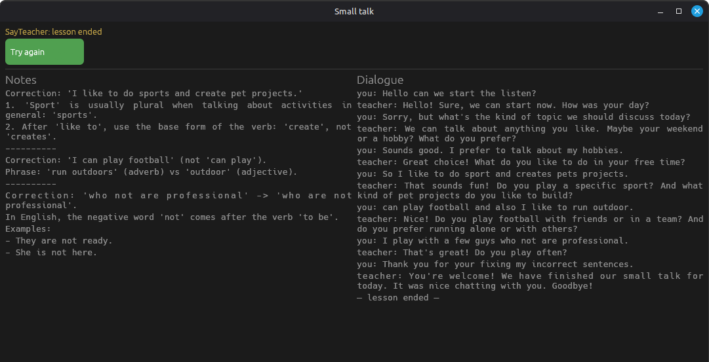
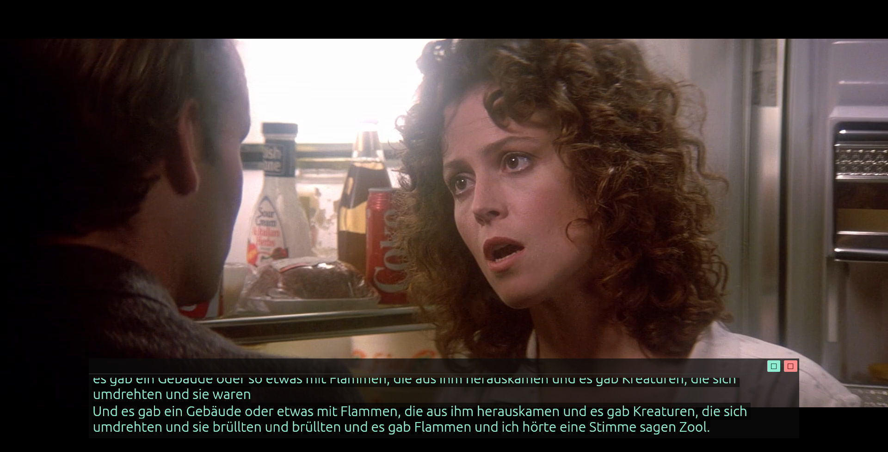
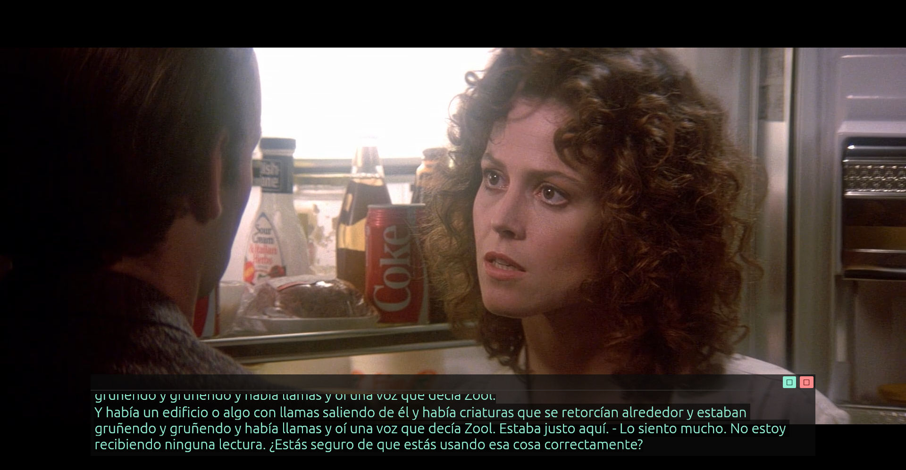

# SayTeacher

English conversation training on your own GPU. Speech recognition with [faster-whisper](https://github.com/SYSTRAN/faster-whisper) (the `distil-medium.en` model from `distil-whisper/distil-medium.en`), voice generation, and lesson creation on topics you choose.



## Components

- A UI application that listens to and plays audio, showing teacher notes and the content of the dialogue:

  

  

- Another app that runs locally (or on a system with a suitable GPU or MLX). It uses two models for speech and voice processing and talks to an OpenAI-compatible LLM API.

  The UI app and this one exchange data over the [datatraffic](https://github.com/unaxfromsibiria/datatraffic) library - linked as `libdatatraffic` in Rust and imported as the `pydatatraffic` package in Python (Redis pub/sub + AES-256-GCM).

- An LLM server - llama.cpp, ollama, or any OpenAI-compatible endpoint - somewhere nearby in your network, or in a Docker container on the same machine.

Serve one of the quantized GGUF models with llama.cpp (see below) and even the larger ones fit in a 12 GB GPU - and it works great.

## Running

Manual commands to launch the apps:

First app (UI):

```bash
cd microagent
RUST_LOG=info cargo run -- --lesson ../files/l2.md
```

Second app (pointing at a llama.cpp server):

```bash
HF_HUB_OFFLINE=1 python -m sayteacher.main --llm-api 'http://localhost:8080/v1' --llm-model '/models/Huihui-gemma-4-12B-it-abliterated.Q4_K_M.gguf'
```

### Running the LLM with llama.cpp

You can serve any of the quantized GGUF models with [llama.cpp](https://github.com/ggml-org/llama.cpp). These parameters keep even the larger models within 12 GB VRAM:

```text
    -m /models/Huihui-gemma-4-12B-it-abliterated.Q4_K_M.gguf
    -c 65536 -ngl 99 -fa on -n '-1' -b 1024 -ub 1024
    --temp 0.2 --min-p 0.05 --top-p 1.0 --top-k 0 --presence-penalty 0.0 --repeat-penalty 1.1
```

Then point `--llm-api` at the server (`http://localhost:8080/v1`) and `--llm-model` at the model file.

## Live subtitles for movies, podcasts, and conversations

Beyond one-on-one practice with an LLM teacher, you can follow along with any English audio - a movie, a TV show, a podcast, or a conversation with a native speaker. Two additional components handle this:

- **outvoiceagent** - a small transparent overlay that captures your system's audio output (loopback) and displays translated text scrolling like subtitles.
- **transcreenpt** - a background service performing speech recognition (faster-whisper) and real-time translation into the target language of your choice. Multiple languages are supported.

Together they turn any English audio into live bilingual subtitles on your screen.





### Running

Download the speech model once (if not already present):

```bash
hf download distil-whisper/distil-medium.en
```

Then launch both components:

```bash
# Terminal 1 - subtitle overlay (captures system audio, displays translated text)
cd outvoiceagent
RUST_LOG=info cargo run -- --listen 0.0.0.0:16050 --device auto --delay 4.5

# Terminal 2 - recognition + translation service
HF_HUB_OFFLINE=1 python -m transcreenpt.main --model 'distil-medium.en' --debug --tolang german --parallel 2
```

Both support `--help` for the full list of options (target language, model, parallelism, etc.).

## Starting with Docker

Startup works as usual - fill in the environment variables in `docker-compose.yaml` and start it:

```bash
docker compose up -d --build
# run the model download manually
docker compose exec sayteacher-api bash -c 'HF_HUB_OFFLINE=0 hf download distil-whisper/distil-medium.en'
```

For example, everything I had to specify:

```text
      - CONNECT=10.1.1.2:16050
      - LLM_MODEL=/models/Huihui-gemma-4-12B-it-abliterated.Q4_K_M.gguf
      - LLM_API=http://10.1.1.3:8080/v1
```

## How to create lessons?

The lesson files are in the `files` directory - come up with topics you find interesting based on the examples. For instance, you can write a chapter from a book there and have it discussed. I may attach some well-working lesson examples here as well.

## LLM-assisted development

Local LLM models (~30b) were used during development in a moderate and careful manner - for boilerplate parts like the `help` message, doing it by hand is no longer appealing. Even so, I still strive to keep the code easy to read and comfortable for humans.

## Plans - what else I'd like to do

- Done. Removed `microagent-transport`, now deprecated in favor of datatraffic.

- Done. Switched to a faster speech recognition model and a more popular LLM API format.

- I'll make a web version if I get the chance.

- I'll add various children's lessons to this repository, some that went well in my own teaching practice. Feel free to add ones about your trips or interviews (probably).
