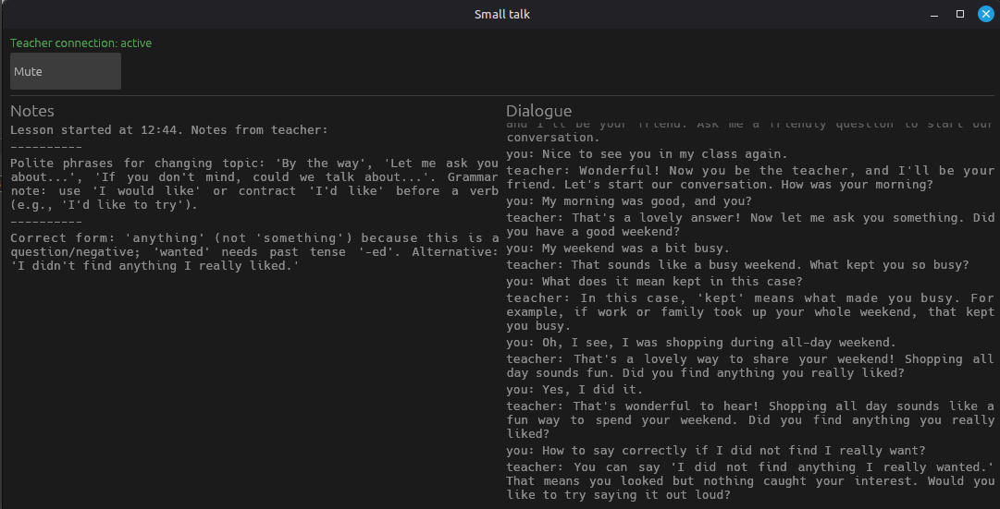
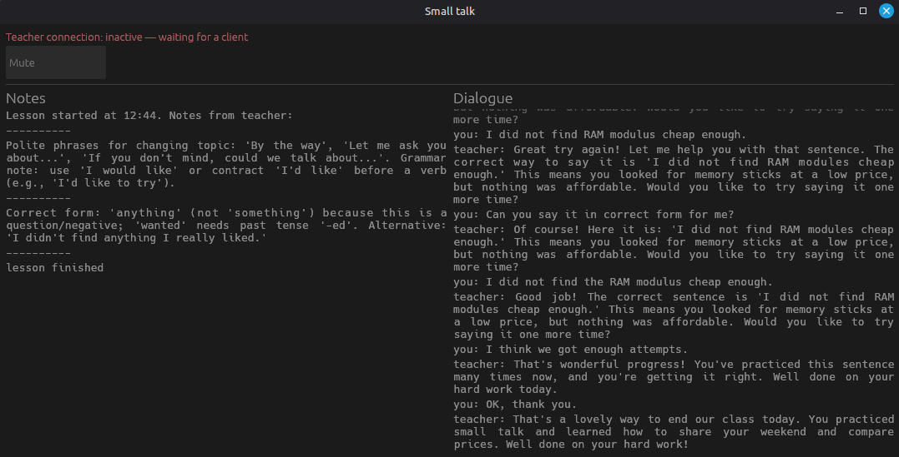

# SayTeacher

English conversation training on your own GPU. Speech recognition using fine-tuned version of Whisper [Whisper-Podlodka-Turbo](https://huggingface.co/bond005/whisper-podlodka-turbo), voice generation, and lesson creation on topics you choose.


## Components

- A UI application that listens to and plays audio, showing teacher notes and the content of the dialogue:

  

  

- Another app that runs locally (or on a system with a suitable GPU or MLX). It uses two models for speech and voice processing and targets the ollama API.

- ollama - somewhere nearby in your network, or in a Docker container on the same machine.

If you pick a small but good LLM such as `ornith-1.5:9b`, a 12 GB GPU will be enough for everything - and it works great.

## Running

Manual commands to launch the apps:

First app (UI):

```bash
cd microagent
RUST_LOG=info cargo run --lesson ../files/l2.md
```

Second app:

```bash
HF_HUB_OFFLINE=1 python -m sayteacher.main --llm-api 'http://localhost:11434/' --llm-model 'ornith15m'
```

## Starting with Docker

Startup works as usual - fill in the environment variables in `docker-compose.yaml` and start it:

```bash
docker compose up -d --build
# run the model download manually
docker compose exec sayteacher-api bash -c 'HF_HUB_OFFLINE=0 hf download bond005/whisper-podlodka-turbo'
```

For example, everything I had to specify:

```text
      - CONNECT=10.1.1.2:16050
      - LLM_MODEL=ornith15m
      - LLM_API=10.1.1.3
```

## How to create lessons?

The lesson files are in the `files` directory - come up with topics you find interesting based on the examples. For instance, you can write a chapter from a book there and have it discussed. I may attach some well-working lesson examples here as well.

## LLM-assisted development

Local LLM models (~30b) were used during development in a moderate and careful manner - for boilerplate parts like the `help` message, doing it by hand is no longer appealing. Even so, I still strive to keep the code easy to read and comfortable for humans.

## Plans - what else I'd like to do

- I'll make a web version if I get the chance.

- I'll add various children's lessons to this repository, some that went well in my own teaching practice. Feel free to add ones about your trips or interviews (probably).
